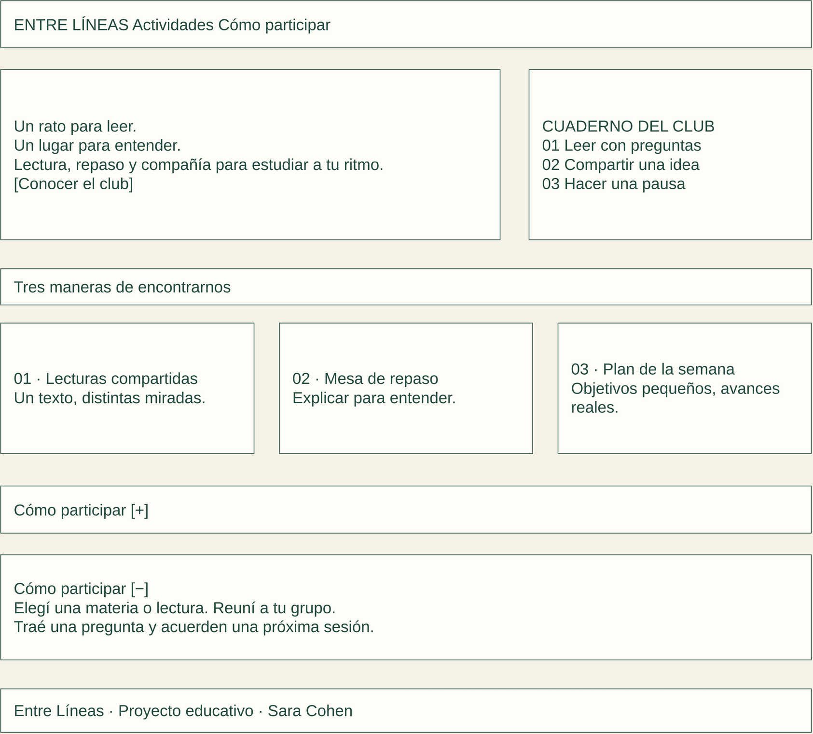
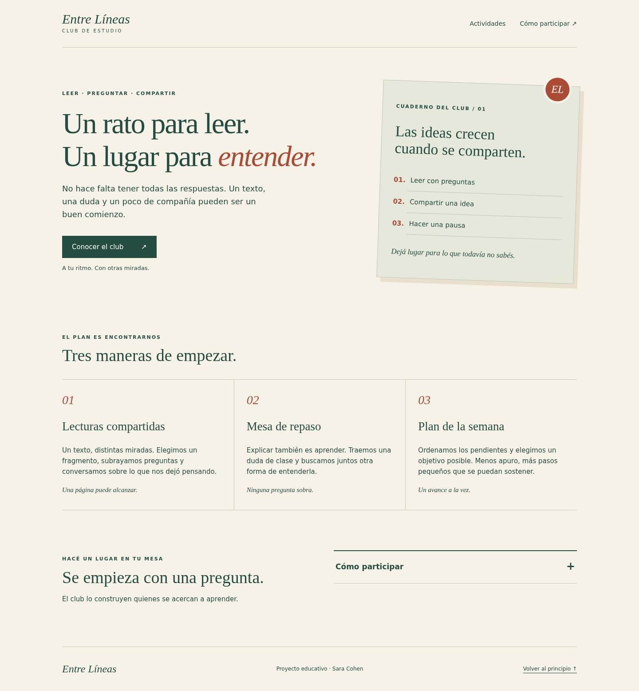
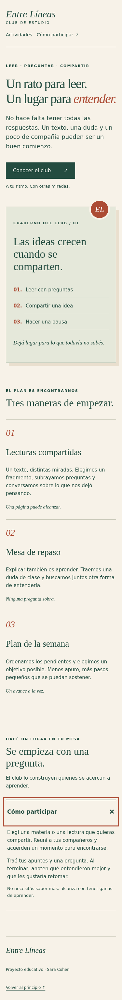

# Entre Líneas · Club de estudio

## 🧩 Datos generales

Estudiante: Sara Cohen. Club Entre Líneas.

## 📄 Sketch

Boceto guardado antes de la implementación.

## Planeamiento

Diseño editorial: papel crema, tinta verde pino y acentos terracota. Títulos serif, controles grandes y disposición adaptable.

## 💬 Prompts utilizados

### Prompt 1

> Implementá una landing educativa en español para Club Entre Líneas siguiendo el boceto: encabezado con navegación, hero de dos columnas con título «Un rato para leer. Un lugar para entender.», cuaderno con tres pasos a la derecha, tres tarjetas de actividades, desplegable Cómo participar y pie. Usá index.html y css/style.css, sin JavaScript ni dependencias externas. Paleta papel crema, verde pino y terracota; títulos Georgia y textos sans del sistema. El desplegable debe usar details/summary y funcionar con teclado. Incluí foco visible, enlace para saltar al contenido y diseño adaptable desde 320 px. No inventes horarios, contactos ni formularios de inscripción.

## Planeamiento de contenido

El club propone compartir lecturas, explicar temas de clase y organizar objetivos semanales. El sitio es una presentación educativa; no toma inscripciones ni anuncia disponibilidad real. Secciones: inicio, actividades y participar. El elemento interactivo explica cómo organizar un grupo, y puede abrirse sin JavaScript.

## 🔄 Diferencias entre versiones

| Versión | Cambio | Motivo |
| --- | --- | --- |
| 1 | Página completa, navegación y desplegable nativo. | Presentar el club sin JavaScript. |

## Pruebas realizadas

- Navegador Chrome: el documento no contiene scripts.
- Enter abre y cierra el desplegable desde el teclado.
- Sin desbordamiento horizontal a 320, 375, 768 y 1280 px.
- Capturas reales de escritorio y móvil, con el desplegable abierto en móvil.

## Estado

- [x] Sketch previo al código.
- [x] Prompt registrado.
- [x] Página funcionando y pruebas realizadas.
- [ ] Publicado en GitHub.

## Repositorio

[Landing page](https://github.com/2023saracohen-yeshurun/landing-page)

## Herramientas utilizadas

HTML y CSS, Visual Studio Code, GitHub, Chrome y archivos Markdown. Asistencia de IA: GPT-6 Luna en las tareas delegadas de implementación y revisión.

[Sitio del proyecto](https://2023saracohen-yeshurun.github.io/landing-page/)
